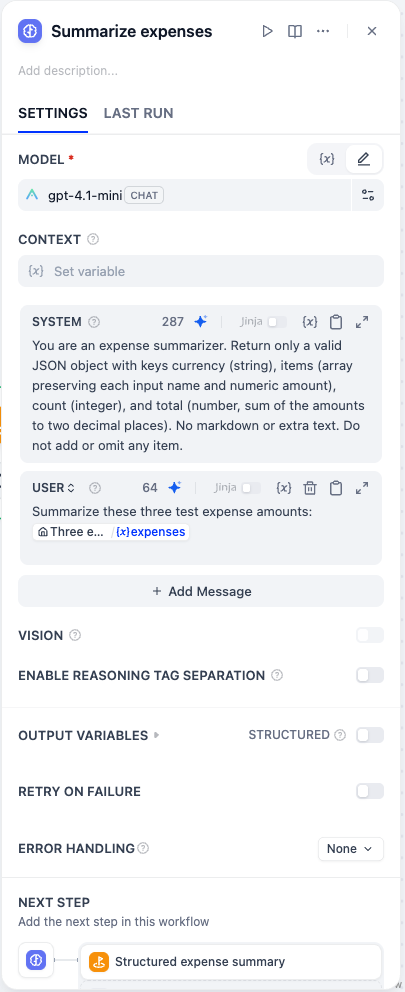
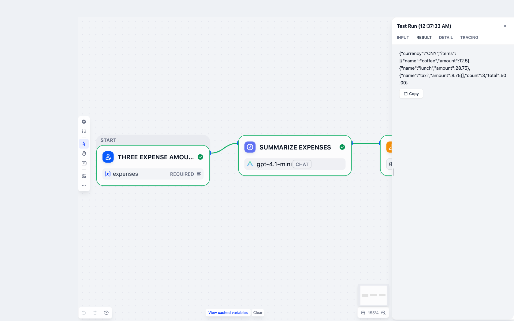

# Ace Data Cloud model provider for Dify

Install **Ace Data Cloud**, save one provider API key, and select any published chat model in an LLM node, an embedding model in Knowledge settings, or speech/transcription models in the corresponding audio settings. The complete typed catalog is included in the plugin: GPT, Claude, Gemini, Grok, DeepSeek, GLM, Kimi and other published chat models. It is not limited to GPT-4.1 mini. Existing custom models and workflow model IDs remain supported; upgrading does not change your workspace defaults.

**Version 0.0.6 source update:** the expanded catalog and embedding/audio interfaces are in this version. Check the version installed in your workspace and the [Marketplace entry](https://marketplace.dify.ai/plugin/acedatacloud/acedatacloud); a source PR or package test does not mean the official release is published. This source version packages 103 chat, 2 embedding, 2 speech and 2 transcription models (109 total) from the current published API contracts. The previously verified Marketplace 0.0.4 contains only the GPT-4.1 mini preset. Source/local packages are not evidence of official Marketplace acceptance.

[Simplified Chinese](https://github.com/AceDataCloud/ModelProviderDify/blob/main/readme/README_zh_Hans.md) · [Install from Marketplace](https://marketplace.dify.ai/plugin/acedatacloud/acedatacloud) · [Source](https://github.com/AceDataCloud/ModelProviderDify)

## 1. Install and authorize the provider

1. Open the Marketplace entry, confirm **Ace Data Cloud** by **acedatacloud**, click **Install**, and select your workspace. Open **Integrations → Model Provider → Ace Data Cloud**. This is a model provider; it does not appear in Tools.
2. Sign in at [Ace Data Cloud → Applications](https://platform.acedata.cloud/console/applications?utm_source=dify&utm_medium=referral&utm_campaign=evergreen&utm_content=modelproviderdify_readme_api_key). Open **General Application**.
3. Copy an authorized application API key, or choose **Manage Keys → Create** to make a key for this Dify workspace. Set its expiry and API/usage restrictions. Do not use a platform management token.
4. In the provider's **Configure** dialog, paste the raw API token into the secret API-key field, without `Bearer` or quotes, and click **Save**. Saving reads `/v1/models` only; it never generates text or embeddings.


A general application key can access services your account is entitled to use; a service-specific key has narrower access. For restricted keys, permit `/v1/models` and the selected operation: `/v1/chat/completions`, `/v1/messages`, `/v1/embeddings`, `/v1/audio/speech` or `/v1/audio/transcriptions`. Confirm access and balance before running a workflow. If Save times out, inspect the existing credential before repeating it.

## 2. Choose a model

- **Chat:** in an LLM node or **Default Models → System Reasoning Model**, select Ace Data Cloud and search for the desired model ID, such as `gpt-6.2-astra`, `gpt-6.2-sol`, a Claude or Gemini model. Selecting an item without running the workflow does not call the model.
- **Embeddings:** in Knowledge settings or the default embedding selector, choose an Ace Data Cloud embedding model. Saving credentials is read-only; indexing documents or running retrieval creates embedding API usage.
- **Speech:** choose `tts-1` or `tts-1-hd` and one of the published voices for text-to-speech; choose `whisper-1` or `gpt-transcribe` for audio transcription. Generating speech or transcribing an uploaded file creates API usage. Credential Save does not run either operation.
- **Chat with image input:** models whose public catalog declares vision expose Dify's image-input capability. `gpt-4o-image` is included because it is a published Chat Completions model. Image-only, audio and video generation APIs belong to their Dify tools, not the LLM selector.

The plugin chooses Chat Completions or Messages using each model's published endpoint bindings, not its name or vendor. A Messages-only model such as `claude-sonnet-5-5` uses `/v1/messages` with the Ace Bearer credential. The catalog does not publish context-window or tool-calling metadata. The plugin leaves unknown context windows and pricing unset, and does not guess tool support from model names. Maximum output defaults to 1,024 tokens as an editable request setting; it is not an advertised model limit. Keep values within the selected model's current documented limits.

For an explicitly configured model, **Add Model** remains available. Use the exact model ID and appropriate type. Existing custom context/output limits and feature settings take precedence, including a deliberate disabled image-input setting. Enable tool calling only for a model that supports it. There is no automatic replacement model or paid retry.

## 3. Keep the catalog current

Dify's native model picker reads the installed plugin's model declarations. Upgrade the plugin after a new Marketplace version is published. Installing from Marketplace does not make Ace a default provider in Dify Cloud or new self-hosted deployments.

The source repository's daily **Sync published model catalog** job reads the [public chat directory](https://platform.acedata.cloud/api/v1/models/) and [typed model catalog](https://platform.acedata.cloud/api/v1/models/catalog/), regenerates every chat, embedding, speech and transcription declaration, validates SDK registration and coverage, and opens a bot PR with a version bump when the catalog changes. Source review and official Marketplace review still apply. A new supported model can also be added through the custom-model form while an updated package is under review.

For maintainers: `python scripts/sync_model_catalog.py --refresh` refreshes the complete snapshot; `python scripts/sync_model_catalog.py --check` checks reproducibility without network access. Do not hand-edit generated model YAMLs.

## Historical workflow example

The example below uses GPT-4.1 mini because that was the model selected for the October 9, 2026 demonstration. It is one example, not the provider's model limit. The historical images do not show or prove the new full catalog. Running the workflow uses current account pricing.

## 4. Create Start → LLM → Output

The expense-workflow example and its result images below are from October 9,2026. They were not rerun for the October 20 setup acceptance. Running the model in step5 uses your account’s current service pricing.

In **Studio**, click **Create → Create from Blank → Workflow**. Name it `Expense summary`. Add an **LLM** node and an **Output** node using **+**, and drag the connectors in this order:

**Start → LLM → Output**.

In **Start**, add a Paragraph input named `expenses` with label `Expenses JSON`, mark it required, and allow at least 2000 characters. In **LLM**, choose **Ace Data Cloud / gpt-4.1-mini**, Temperature `0`, Maximum tokens `400`. Keep failure retries off.

Use this system prompt:

```text
Return only a valid JSON object with keys currency, items, count and total.
Preserve each input name and numeric amount. Count the items and sum their amounts to two decimal places.
Do not add or omit any item. No markdown or extra text.
```

In the user prompt, type `Summarize these expenses:` and use the variable picker to insert **Start → expenses**. Do not paste the API key into a prompt.



In **Output**, add an output named `summary_json` and select **LLM → text** (String).


## 5. Run and compare the result

Click **Test Run**, paste this into **Expenses JSON**, then click **Start Run**:

```json
{"currency":"CNY","items":[{"name":"coffee","amount":12.5},{"name":"lunch","amount":28.75},{"name":"taxi","amount":8.75}]}
```

When the three nodes finish, `summary_json` should be valid JSON with the original items, `count: 3` and `total: 50.00`. This model node returns its completed text directly; do not add a media-task retrieval tool.

```json
{"currency":"CNY","items":[{"name":"coffee","amount":12.5},{"name":"lunch","amount":28.75},{"name":"taxi","amount":8.75}],"count":3,"total":50.00}
```



[Download the importable workflow](https://github.com/AceDataCloud/ModelProviderDify/raw/refs/heads/main/docs/quickstart.dify.yml). Import it in Studio and configure your own key; it contains no credentials.

## Verification and cost

The [October 20, 2026 acceptance record](https://github.com/AceDataCloud/ModelProviderDify/blob/88bf2f25e5c50a0194aadb9e12ed21aea1d3ea89/_assets/tutorial/native-20261020/acceptance.json) proved ordinary signed Marketplace 0.0.4 installation, one credential Save, and selection of its single preset in an unsaved, unrun Dify CE 1.17.1 draft. It is historical evidence, not a new Dify Cloud or 0.0.6 full-catalog UI/inference test.

The plugin is free. Chat, embedding and audio API calls are billed at your account's current Ace Data Cloud prices. Dify may show a zero estimate because this plugin supplies no static price; **zero estimate does not mean free API usage**. The account usage ledger is authoritative. Per-request image-chat prices cannot be represented as token prices.

| Problem | Check |
|---|---|
| Only GPT-4.1 mini appears | Check the installed plugin version; 0.0.4 contains only one preset. Upgrade after official publication. |
| A model cannot be saved | Exact model ID and type, key expiry, service access and Allowed APIs. |
| 401/403 | Key permissions, content policy and balance. Never send the key in a support message. |
| 429 | Wait and reduce concurrency; this plugin does not retry automatically. |
| Timeout or server error | Check request history before resubmitting a billed request. |
| Embedding input is too long | Shorten or explicitly chunk your document; the plugin does not silently truncate input. |

Requests use the fixed `api.acedata.cloud` destination. See [Privacy](https://github.com/AceDataCloud/ModelProviderDify/blob/main/PRIVACY.md). [Issues](https://github.com/AceDataCloud/ModelProviderDify/issues) · dev@acedata.cloud
