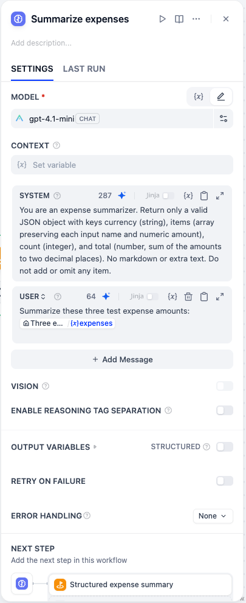
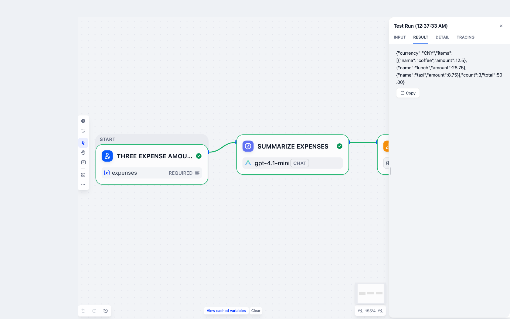

# Ace Data Cloud Dify 模型供应商

安装 **Ace Data Cloud**，保存一次供应商 API Key，即可在 LLM 节点选择公开聊天模型，在知识库中选择向量模型，或在对应音频设置中选择语音与转写模型。插件包含完整的公开类型目录，覆盖 GPT、Claude、Gemini、Grok、DeepSeek、GLM、Kimi 等已发布聊天模型，范围不限于 GPT-4.1 mini。已有自定义模型、工作流模型 ID 与工作区默认设置会保留。

**0.0.6 源码更新：**完整目录、Embedding、语音与转写入口属于此版本。请核对工作区已安装版本与[官方市场版本](https://marketplace.dify.ai/plugin/acedatacloud/acedatacloud)；源码 PR 或包验证通过不代表已正式上架。本源码版本按当前公开 API 合同包含 103 个聊天、2 个向量、2 个语音合成和 2 个转写模型，共 109 个。此前验证过的市场 0.0.4 只有 GPT-4.1 mini 一个预置模型；源码或本地安装包不代表官方市场已批准。

[English](https://github.com/AceDataCloud/ModelProviderDify/blob/main/README.md) · [官方市场安装](https://marketplace.dify.ai/plugin/acedatacloud/acedatacloud) · [源码](https://github.com/AceDataCloud/ModelProviderDify)

## 1. 安装并配置供应商

1. 在市场确认 **Ace Data Cloud**、作者 **acedatacloud**，点击 **Install** 并选择工作区。打开 **Integrations → Model Provider → Ace Data Cloud**。这是模型供应商，不在 Tools 列表里。
2. 登录[应用列表](https://platform.acedata.cloud/console/applications?utm_source=dify&utm_medium=referral&utm_campaign=evergreen&utm_content=modelproviderdify_readme_api_key)，打开**通用应用**。首次使用时若尚未初始化，先点击**初始化通用应用**，然后点击 **API KEY** 旁的复制按钮（图中标注 **1**）。

   

3. 在供应商 **Configure** 窗口的保密字段粘贴原始 Token，不加 `Bearer` 或引号，点一次 **Save**。保存只读取 `/v1/models`，不会生成聊天内容或向量。

如需为 Dify 工作区单独创建密钥，可在**管理密钥**中设置有效期、接口范围和用量限制。设置 Allowed APIs 时，允许 `/v1/models`，以及要使用的 `/v1/chat/completions` `/v1/embeddings`、`/v1/audio/speech` 或 `/v1/audio/transcriptions`。运行前确认权限和余额；保存超时应先检查已有凭据。

## 2. 选择模型

- **聊天：**在 LLM 节点或 **Default Models → System Reasoning Model** 中选 Ace Data Cloud，搜索需要的模型 ID，例如 `gpt-6.2-astra`、`gpt-6.2-sol`、Claude 或 Gemini。只选择模型而不运行工作流，不会调用模型。
- **向量：**在知识库或默认 Embedding 选择器中选 Ace Data Cloud 向量模型。保存凭据只读；文档索引或实际检索会产生 Embedding API 用量。
- **语音：**文字转语音可选 `tts-1`、`tts-1-hd` 及公开音色；语音转写可选 `whisper-1`、`gpt-transcribe`。实际合成或转写上传文件会产生 API 用量，保存凭据不运行这两种操作。
- **图片输入：**公开目录声明支持 vision 的聊天模型会开启 Dify 图片输入。`gpt-4o-image` 属于公开 Chat Completions 模型，因此保留在聊天列表中。仅图片、音频和视频生成接口走对应的 Dify 工具入口。

插件依据每个模型的公开端点绑定选择 Chat Completions 或 Messages 协议，不按名字或厂商猜测。仅支持 Messages 的模型，例如 `claude-sonnet-5-5`，使用 `/v1/messages` 和 Ace Bearer 凭据。公开目录未提供上下文窗口与工具调用元数据；插件不猜测这些字段，也不把厂商参考价格当作账号价格。最大输出默认 1,024 Token，是可调整的请求设置，不是模型能力上限；请遵守所选模型的当前文档限制。

**Add Model** 仍支持显式自定义模型。填写准确的模型 ID 与类型。已有自定义上下文、输出长度和能力设置优先，包括主动关闭图片输入的配置。仅对支持工具调用的模型开启该功能。插件不会自动替换模型，也不会自动重试付费请求。

## 3. 目录如何更新

Dify 原生模型选择器读取已安装插件里的声明。新的官方市场版本发布后，需要升级插件才能看到新目录。市场可安装不表示 Dify Cloud 或新部署的工作区默认安装 Ace。

源码仓库每日执行 **Sync published model catalog**：读取[公开聊天目录](https://platform.acedata.cloud/api/v1/models/)与[模型类型目录](https://platform.acedata.cloud/api/v1/models/catalog/)，生成全部聊天、向量、语音与转写模型声明，检查 SDK 注册和目录覆盖；发现变化后由 Dev bot 创建带版本升级的 PR。源码审核与官方市场审核仍须正常完成。待新版审核期间，也可通过自定义表单添加已支持的新模型。

维护者可用 `python scripts/sync_model_catalog.py --refresh` 刷新完整快照，或用 `python scripts/sync_model_catalog.py --check` 离线检查生成结果。不要手改生成的模型 YAML。

## 历史工作流示例

下方金额汇总示例使用 GPT-4.1 mini，因为2026年10月9日的演示选择了它；这是一个示例，不代表模型范围。旧图不展示或证明新版完整目录。实际运行按账号当前价格计费。

## 4. 连接 Start → LLM → Output

以下金额汇总工作流及结果图是2026年10月9日历史示例，没有在10月20日接入验收中重跑。执行第5步模型请求时，会按账号当前服务价格计费。

进入 **Studio → Create → Create from Blank → Workflow**，命名为 `Expense summary`。用 **+** 添加 LLM 和 Output 节点，将右侧连接点依次连为 **Start → LLM → Output**。

Start 新增 Paragraph（多行文本）输入，变量名 `expenses`，标签 `Expenses JSON`，设为必填，最大长度至少 2000。LLM 节点选择 **Ace Data Cloud / gpt-4.1-mini**，Temperature 填 `0`，Maximum tokens 填 `400`，失败重试关闭。

系统提示词填写：

```text
Return only a valid JSON object with keys currency, items, count and total.
Preserve each input name and numeric amount. Count the items and sum their amounts to two decimal places.
Do not add or omit any item. No markdown or extra text.
```

用户提示词填写 `Summarize these expenses:`，再从变量选择器插入 **Start → expenses**。不要把 API Key 放进提示词。



Output 新增 `summary_json`，变量选择 **LLM → text**，类型为 String。


## 5. 实际运行并核对结果

点 **Test Run**，在 **Expenses JSON** 中粘贴：

```json
{"currency":"CNY","items":[{"name":"coffee","amount":12.5},{"name":"lunch","amount":28.75},{"name":"taxi","amount":8.75}]}
```

点 **Start Run**。三个节点完成后，`summary_json` 应是合法 JSON，保留三项输入，`count` 为 3，`total` 为 50.00。聊天模型直接返回完成后的文本，不需要媒体任务查询节点。

```json
{"currency":"CNY","items":[{"name":"coffee","amount":12.5},{"name":"lunch","amount":28.75},{"name":"taxi","amount":8.75}],"count":3,"total":50.00}
```



[下载可导入工作流](https://github.com/AceDataCloud/ModelProviderDify/raw/refs/heads/main/docs/quickstart.dify.yml)。在 Studio 导入后配置自己的 Key，文件不含凭据。

## 验证范围与费用

[2026年10月20日历史验收记录](https://github.com/AceDataCloud/ModelProviderDify/blob/88bf2f25e5c50a0194aadb9e12ed21aea1d3ea89/_assets/tutorial/native-20261020/acceptance.json)证明了正常签名安装市场 0.0.4、一次凭据保存和在 Dify CE 1.17.1 未保存且未运行的草稿中选择单个预置模型。它不是新版0.0.6全目录界面、Dify Cloud或新付费推理的验证。

插件免费，聊天、向量与音频请求按 Ace Data Cloud 账号当前价格计费。插件没有提供固定价格，Dify 可能显示零估算；**零估算不等于 API 免费**，实际以账号用量账单为准。按请求计费的图片聊天也不能冒充 Token 单价。

| 问题 | 检查 |
|---|---|
| 只看到 GPT-4.1 mini | 核对已安装版本；0.0.4 只有一个预置，待新版正式发布后升级。 |
| 无法保存模型 | 精确模型 ID 和类型、Key 有效期、服务权限与 Allowed APIs。 |
| 401/403 | Key 权限、内容策略、余额；不要发送 Key 给客服。 |
| 429 | 等待并降低并发；插件不自动重试。 |
| 超时或服务错误 | 重发付费请求前先检查原请求记录。 |
| Embedding 输入过长 | 显式缩短或切分文档；插件不会静默截断输入。 |

请求固定发往 `api.acedata.cloud`。参见[隐私政策](https://github.com/AceDataCloud/ModelProviderDify/blob/main/PRIVACY.md)。[问题反馈](https://github.com/AceDataCloud/ModelProviderDify/issues) · dev@acedata.cloud
